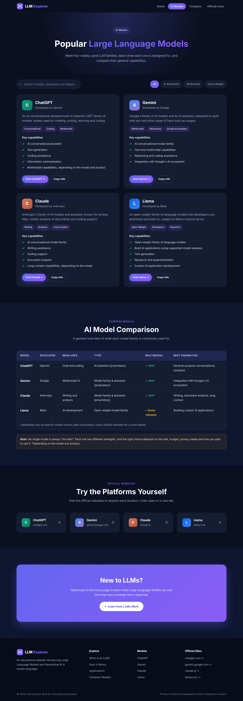
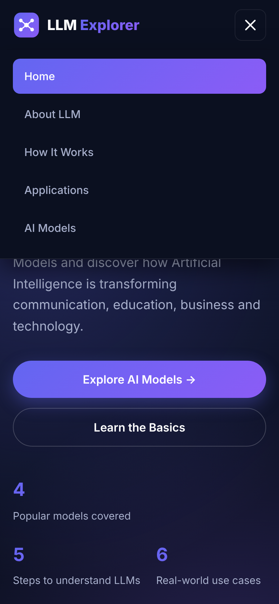

# 🤖 LLM Explorer – Responsive Frontend Project

A professional, responsive two-page website developed using **HTML5, CSS3 and JavaScript** that introduces users to **Large Language Models (LLMs)** and **Generative AI**.

This website explains how LLMs work, presents popular AI models such as **ChatGPT, Gemini, Claude and Llama**, compares their capabilities and provides links to their official platforms.

Designed for learning, portfolio presentation and placement-level frontend demonstration.

> ℹ️ This project demonstrates LLM knowledge and frontend development. It does not implement an LLM itself and uses no backend, database or AI API.

---

## 🌐 Live Demo

🔗 **https://deswanth.github.io/llm-explorer/**

---

## 🚀 Live Features

✔ Responsive navigation bar with mobile hamburger menu
✔ Hero section with animated AI chat and token demo
✔ What is an LLM? – AI, ML, Deep Learning, NLP, Generative AI and Transformers
✔ Interactive 5-step "How LLM Works" walkthrough with examples
✔ Key features and real-world applications of LLMs
✔ Advantages and limitations section
✔ AI Models page – ChatGPT, Gemini, Claude and Llama
✔ Search models functionality
✔ Filter models by category (AI Assistants, Multimodal, Open-Weight)
✔ Copy model information with one click
✔ AI model comparison table
✔ Official website links for each AI platform
✔ Scroll animations and back-to-top button
✔ Clean modern dark UI
✔ Fully responsive – desktop, laptop, tablet and mobile

---

## 🛠️ Tech Stack

### 👨‍💻 Frontend

* HTML5
* CSS3 (Flexbox, Grid, Media Queries, CSS Variables)
* JavaScript (ES6)
* Responsive UI design

### 🧠 AI Concepts Covered

* Large Language Models (LLMs)
* Generative AI
* Natural Language Processing (NLP)
* Transformer Architecture
* Tokenization and Embeddings

### 🔧 Tools Used

* VS Code
* Live Server
* Google Chrome
* Git & GitHub
* GitHub Pages

---

## 📸 Project Screenshots

### 🏠 Home Page


### 🤖 AI Models Page



### 📱 Mobile View – Home


### 📱 Mobile View – Navigation Menu



### 📱 Mobile View – AI Models


---

## 📂 Project Structure

```text
llm-explorer/
│
├── index.html          # Home page
├── models.html         # AI Models page
│
├── css/
│   └── style.css       # All styling and responsive design
│
├── js/
│   └── script.js       # Interactivity (menu, steps, search, filter, copy)
│
├── assets/
│   ├── images/
│   ├── icons/
│   └── logos/
│       └── logo.svg
│
├── screenshots/        # Project screenshots
├── README.md
└── .gitignore
```

---

## 🎨 Colour Palette

| Element         | Colour    |
| --------------- | --------- |
| Background      | `#0B1020` |
| Primary         | `#6366F1` |
| Secondary       | `#8B5CF6` |
| Text            | `#FFFFFF` |
| Card Background | `#151D33` |

---

## 📊 AI Model Comparison

| Model   | Developer | Main Uses            |
| ------- | --------- | -------------------- |
| ChatGPT | OpenAI    | Chat and coding      |
| Gemini  | Google    | Multimodal AI        |
| Claude  | Anthropic | Writing and analysis |
| Llama   | Meta      | AI development       |

*Capabilities vary by model version and product. No single model is always the best – it depends on the task.*

---

## 💻 How to Run Project

1. Clone repository

   ```bash
   git clone https://github.com/deswanth/llm-explorer.git
   ```

2. Open the project folder in VS Code

   ```bash
   cd llm-explorer
   code .
   ```

3. Install the **Live Server** extension in VS Code

4. Right-click `index.html` → **Open with Live Server**

**Or** simply double-click `index.html` to open it in any browser – no installation required.

---

## 🧪 Testing

✔ Home and Models pages load correctly
✔ All navigation links work
✔ All model cards display correctly
✔ External links open in a new tab
✔ Search, filter and copy features work
✔ Responsive layout tested on mobile and desktop
✔ No JavaScript console errors

---

## 🔮 Future Enhancements

* 🌙 Dark / light mode toggle
* 🌐 Multiple language support
* ⭐ Favourite AI models
* 📊 Advanced model comparison and benchmarks
* 💬 AI chatbot integration using an LLM API
* 📰 AI news and updates section

---

## 🎯 Project Purpose

This project was built for:

* Learning Large Language Model and Generative AI concepts
* Frontend web development practice
* Software developer placements
* Portfolio and interview demonstration

---

## 👨‍💻 Developed By

**Deswanth PADAKALA**

---

## ⭐ If you like this project

Give this repo a ⭐ on GitHub

---

*Product names and trademarks belong to their respective owners. This website is for educational purposes only.*
